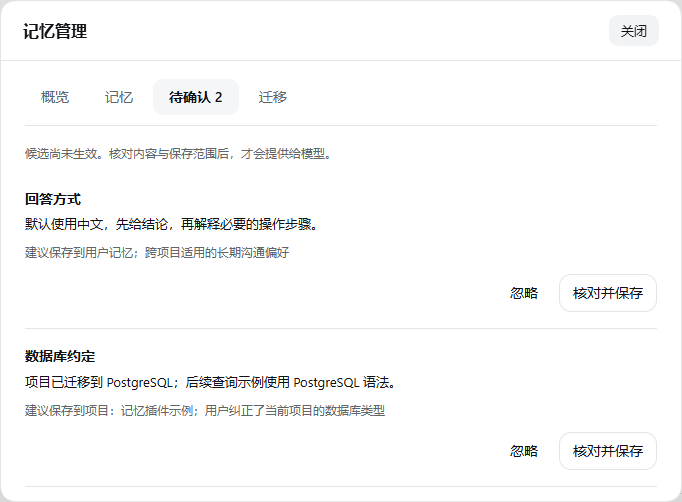

# dsh-tool-user-memory

[](https://www.npmjs.com/package/dsh-tool-user-memory) [](https://github.com/IAMLieutenant/dsh-tool-user-memory/actions/workflows/ci.yml) [](LICENSE)

**新开一个会话，也不用从头交代。**

给 [DeepSeek Harness](https://github.com/deepseek-ai/deepseek-harness) 保存你的回答偏好、项目约定和已经确认的事实。比如“默认用中文”“改数据库前先给回滚方案”“这个项目已经换成 PostgreSQL”。以后在相关会话里，助手可以继续参考这些记忆。

你可以在 DSH 里查看和修改它们。记忆保存在本机的 Markdown 文件中，换电脑时也能导出带走。本项目由社区独立维护。

[English](README.en.md) · [安装与上手](#安装与上手) · [详细使用说明](docs/reference.md) · [更新日志](CHANGELOG.md)

**`0.4.1`：先核对，再记住。** 新增待确认记忆、来源核对和同名纠正预览，详见 [Release](https://github.com/IAMLieutenant/dsh-tool-user-memory/releases/tag/v0.4.1)。



## 这次更新了什么

这次增加了一条**先看一眼，再保存**的路径。

假设项目原来用 MySQL，你后来告诉助手：“已经迁到 PostgreSQL 了。”助手现在可以先提交一条候选。你打开管理窗口，看看它理解得对不对、该存到哪里，再确认保存。

| 你能做什么 | 具体变化 |
|---|---|
| 先审核，再记住 | 新增“待确认”列表。候选没确认，就不会当成记忆使用；不想要的可以忽略。 |
| 看看依据是什么 | 候选可以带上会话和原话片段。片段匹配到最近实际收到的用户消息，才显示“已匹配”；找不到就标为“未核验”。匹配到原话，不代表理解一定正确。 |
| 选清楚记在哪里 | 通用偏好存到“用户记忆”，项目事实存到来源项目。项目记忆不会提供给其他项目。 |
| 把旧内容改过来 | 用同一个名称纠正记忆时，先对照旧内容和新内容。确认后正常读取使用新内容，旧内容保留在修改历史中。 |


这条流程是新增选项。原来的直接保存方式仍然保留；插件也不会自动把所有聊天都变成候选。

## 一分钟试一下

1. 在一个项目的 DSH 会话里，把下面这句话发给助手：

   > 请用 memory_propose 提交一条待确认记忆：这个项目已经迁到 PostgreSQL，后续 SQL 示例使用 PostgreSQL 语法。范围选 workspace，先不要直接保存。

2. 打开 **插件 → dsh-tool-user-memory → 管理记忆 → 待确认**。
3. 点击 **核对并保存**，看看内容、来源和保存范围。觉得不准确，可以直接修改。
4. 点击 **预览变更**，核对后再 **确认保存**。如果不需要，就取消或忽略。
5. 新开同一项目的会话，让助手检查项目记忆，确认它能读到新的数据库约定。

需要演示纠正时，先在项目记忆中保存一条同名的“数据库约定”，内容写“项目使用 MySQL”。再走一遍上面的流程，就能看到新旧内容对照。

如果只是明确保存一条偏好，也可以说：“使用 memory_update 记住我的回答偏好：默认中文，先给结论。”

## 记忆放在哪里，自己说了算

- **用户记忆**：适合语言、沟通方式等跨项目偏好。
- **项目记忆**：适合某个项目的技术选择、约定和背景。
- **待确认**：还没有生效，等你决定是否保存。
- **迁移**：换电脑时导出、映射项目、预览并导入；需要时撤销本次导入。

重要的用户记忆可以置顶。置顶后优先保留和提供给模型，但一次能提供多少内容仍有长度限制。

管理窗口沿用 DSH 的颜色和字体，浅色、深色一起切换。确认按钮固定在弹窗底部，小窗口里也能操作。


## 安装与上手

### 使用已发布的正式版

已安装 DSH 的环境中运行：

```sh
dsh plugin --profile web add dsh-tool-user-memory@0.4.1
```

`0.4.1` 包含本文的候选确认流程，以及原有的记忆管理、置顶、项目隔离和迁移。

### 从源码构建

在仓库根目录构建并安装本地包：

```sh
pnpm install --frozen-lockfile
pnpm run build
pnpm pack
dsh plugin --profile web add ./dsh-tool-user-memory-0.4.1.tgz
```

把 `web` 换成实际使用的 profile。安装或升级后重启 DSH；网页模式需要重启服务，单纯刷新页面不够。

`0.4.1` 的管理入口直接在插件详情页。`0.4.0` 可能需要先进入组件的“配置”，再打开“管理记忆”。

已有记忆可以继续读取。`0.4.1` 会增加来源信息，回退旧版前请保留升级前备份；不要用旧版命令重新保存新版数据。

## 使用前要知道

- **保存成功、提供给模型、回答实际遵循，是三件事。** 可以先让助手读取记忆，再检查回答是否真的用对了。
- **记忆存本机，不代表模型处理也离线。** 使用记忆时，相关内容会随请求发给你配置的模型服务；不要存密码或密钥。
- **删除活动记忆后，历史和备份仍可能保留。** 修改恢复与彻底清除的规则见详细说明。
- 当前检索主要靠关键词；语义检索、自动提取全部历史聊天、加密同步还没有实现。

## 想看更多

| 文档 | 内容 |
|---|---|
| [使用与配置参考](docs/reference.md) | 置顶、迁移、容量、工具参数、存储位置和排错 |
| [候选确认说明](docs/candidate-review.md) | 来源怎样核验、纠正怎样保存、候选怎样恢复 |
| [开发与验证](docs/development.md) | 构建命令、测试结果和实际浏览器验证范围 |
| [更新日志](CHANGELOG.md) | 每版具体改动 |
| [后续计划](ROADMAP.md) | 接下来考虑做什么 |

`0.4.1` 通过 **139 项自动化测试和构建**，并在独立的 DSH `0.2.1-rc.2` 网页环境中实际验证了管理入口、候选确认、主题切换和窄窗口布局。截图使用演示记忆；真实模型的长期记忆效果仍需继续验证。

问题和建议欢迎提到 [Issues](https://github.com/IAMLieutenant/dsh-tool-user-memory/issues)。代码使用 [MIT 许可证](LICENSE)。
