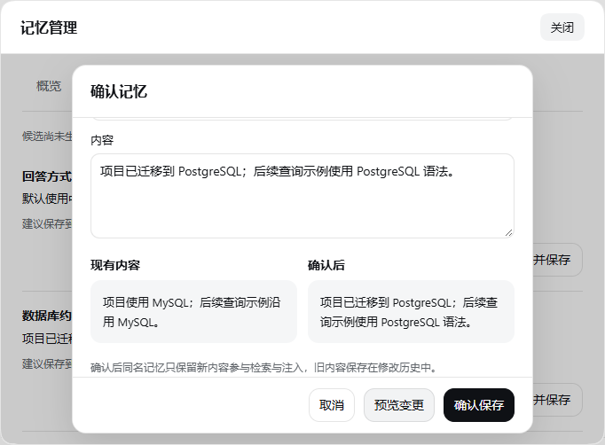
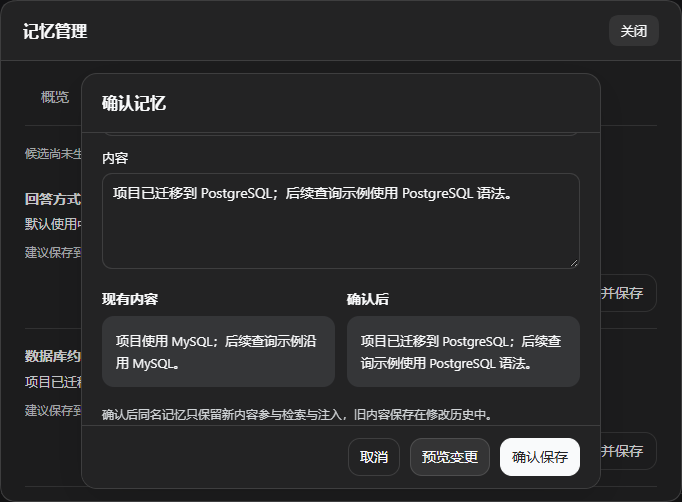

# 候选确认（0.4.1）

`0.4.1` 新增候选确认流程，安装方式见 [首页](../README.md#安装与上手)。

## 使用流程

1. 告诉助手：“请用 memory_propose 提交一条待确认记忆：这个项目已经迁到 PostgreSQL，后续例子使用 PostgreSQL；范围选 workspace。”
2. 插件 → dsh-tool-user-memory → 管理记忆 → 待确认。入口直接位于插件详情页。
3. 点击“核对并保存”，检查引用、内容与保存范围。用户记忆适用于全部项目；项目记忆仅适用于候选的来源项目。
4. 点击“预览变更”。同名记忆会显示现有内容与确认后内容；需要纠正时复用原名称。
5. 点击“确认保存”。后续请求才会按原有预算和范围读取记忆。确认后不保证每次回答都实际遵循。

工具需要明确指定 `scope`；项目候选必须能从执行它的会话中取得有效工作目录。工具不接收模型提供的来源会话 ID，也不提供确认候选的工具。现有 `memory_update` 仍保留，供用户明确要求直接保存时使用；本次没有强制把所有旧写入改成待确认。

## 来源和确认的含义

- “已匹配会话记录”：引用是插件加载后观察到的最近 10 条直接用户消息之一的连续片段，并记录其宿主事件位置。每条消息仅检查前 20,000 字符；不扫描旧会话文件或推理过程。
- “未核验”：插件没有在上述窗口内找到引用。它仍可供用户核对，但不能当作已验证原话。
- 匹配只验证片段确实存在，不证明候选含义正确。用户确认也不是模型准确遵循的证明。
- 老记忆没有来源时按未知显示。新字段的 `createdAt` 是来源记录首次建立时间，不冒充旧记忆原始创建时间。
- 修改正文的后续工具写入／整理会去掉原确认及证据关联，标为工具修改。置顶操作保留来源、年龄和状态。
- 同名替换只保留新正文参与常规读取；旧正文在历史快照中保留，最近替代内容也可在管理页查看。每文件历史仍按原规则保留 20 份。

## 数据和恢复

候选存放在实际画像文件旁的 `<画像文件名>.candidates.json`，自定义画像之间互相隔离。最多 100 条待确认和最近 200 条已处理记录，文件上限 2 MiB。忽略不会把内容加入活动记忆。未确认、已忽略候选均不随迁移导出；完整备份需要复制实际存储目录。

来源为画像／主题 Markdown 中编码的可选注释，与正文分离，不注入来源引用或被替代正文。新版迁移保留来源元数据。旧版插件不理解这些新增字段，重新保存可能丢失或错误处理来源信息；回退时使用升级前备份。

预览后修改内容、范围、置顶状态或目标记忆，必须重新预览。候选确认超出容量会拒绝操作，保留原活动记忆。目标已保存但队列更新中断时，再次确认同一内容可补记完成状态；若目标已被其他操作修改，需要重新核对。队列状态与目标文件不是一个文件系统事务。

来源、历史、候选和导出都可能包含原文。普通的编辑／删除不等于彻底擦除这些副本。管理页使用既有本机同源与请求令牌保护；具有不受限文件或 Shell 权限的模型／进程仍可改写本地文件，UI 确认不构成 OS 安全隔离。

## 本次验证

自动化回归覆盖候选未生效隔离、去重、同名替换、来源匹配、注入、项目隔离、用户选择范围、过期预览、容量拒绝、忽略、来源迁移与中断后重试。Harness 集成测试使用固定响应，不代表真实模型提取或遵循效果。

`0.4.1` 在锁定依赖 `0.1.7-alpha.1` 上共 139 项测试通过，TypeScript 构建通过。新增候选纠正默认保留已有置顶状态，除非审阅者明确修改。

在 Windows 的独立测试 profile 中，使用本机桌面版随附的官方 DSH `0.2.1-rc.2` 内核与 Chrome 实际验证：正式插件安装与详情入口、候选预览、范围变化使预览失效、取消、确认保存、项目记忆中的新内容与来源展示；浅色／深色切换时的 DSH 颜色继承，以及 420px 宽窗口无横向溢出。测试没有使用真实账号或模型服务，也没有修改日常 DSH 配置。浏览器测试不能证明 Electron 原生窗口和全部 DSH 版本均兼容。

语义检索、历史会话批量抽取、会话文本选择菜单、自动候选提取和模型效果基准未包含在 `0.4.1`。

## 实际 DSH 页面截图

截图使用隔离的虚构示例记忆。

